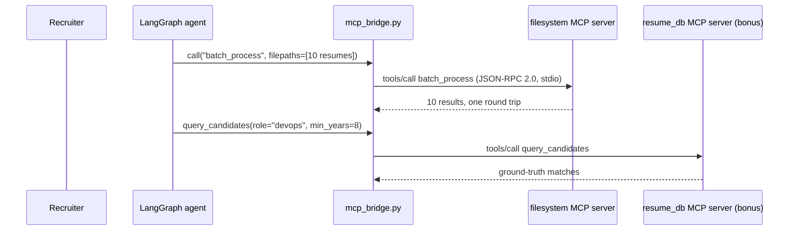
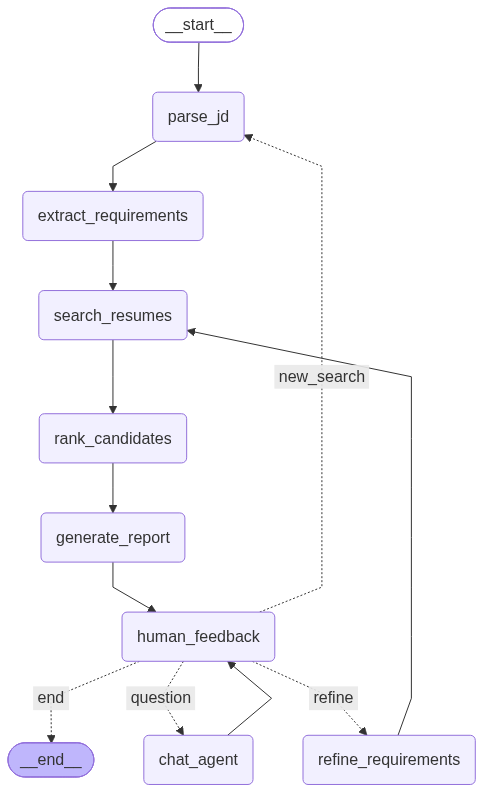

# Resume Matching Agent — MCP Edition (Milestone 4)

A conversational **LangGraph** agent that screens 100 resumes against a job description in three rounds, explains every ranking, and lets a recruiter refine requirements mid-conversation. Milestone 4 replaces the agent's direct file-system access with two **Model Context Protocol (MCP)** servers, reached through a standard MCP client — the agent no longer touches the filesystem itself. It builds on:

- **Milestone 1:** file-system tools (`fs_tools.py`: read PDF/DOCX/TXT, list, write, search) — now used **only inside the MCP server**, not by the agent directly
- **Milestone 2:** resume RAG (`resume_rag.py`, MiniLM + ChromaDB) and the hybrid matcher (`job_matcher.py`)
- **Milestone 3:** the LangGraph agent itself (`matching_agent.py`, `agent_tools.py`), refactored here for Part B

```
you › jobs/jd_platform_engineer.txt
  · [parse_jd] JD source: jobs/jd_platform_engineer.txt (31 words)
  · [extract_requirements] [llm] must-have=['Go', 'Kubernetes'] nice-to-have=['AWS', 'Prometheus', 'Terraform'] min_years=5
  · [search_resumes] Round 1: scored 100 resumes -> top 10 (6 meet every must-have + years)
  · [rank_candidates] Round 2: deep analysis of 10 candidates
  · [rank_candidates] Round 3: verdicts {'hire': 6, 'maybe': 4, 'no-hire': 0}
  · [generate_report] Match report written to reports/senior_platform_engineer_v1_....md (via MCP filesystem server)
you › Start watching the resumes directory for new candidates
  · [chat_agent] tool watch_directory(action='start', directory='resumes')
  ...a new resume lands on disk mid-conversation (demo/flows/08)...
you › What new files have appeared since you started watching?
  · [chat_agent] tool watch_directory(action='events', directory='resumes')
```

## Architecture

### Part A — two MCP servers (`filesystem_mcp_server.py`, `resume_db_mcp_server.py`)


Full sequence: [`docs/mcp_architecture.mmd`](docs/mcp_architecture.mmd) / `.png`. Both servers are built with the official `mcp` SDK's `FastMCP`, run over **stdio** by default (the SDK's recommended transport for a locally-spawned server driven by one long-running client — see `--transport streamable-http` below for the alternative), and speak **JSON-RPC 2.0** as the wire protocol — that's the MCP spec, not something layered on top.

**`filesystem_mcp_server.py`** — converts every Milestone 1 tool to MCP, plus two MCP-native capabilities:

| Tool | What it does |
|---|---|
| `read_file`, `list_files`, `write_file`, `search_in_file` | Milestone 1 parity, now served over MCP |
| `batch_process(filepaths, operation)` | Reads/stats many files **concurrently** (ThreadPoolExecutor) in one round trip instead of one `read_file` call per file. Round 2 uses this for all shortlisted candidates at once. |
| `watch_directory(action, directory)` | Starts a `watchdog` `Observer` on a directory; `action="events"` returns what's changed; on every change the server also emits a spec-compliant `notifications/resources/list_changed` to the client. |

Resources (discovery endpoints — `resources/list`, `resources/templates/list`): `resumes://directory` (every resume's metadata), `resume://{filename}` (one resume's text), `config://server` (the live configuration).

**Error handling has two channels**, matching how the MCP spec treats them differently:
- **Soft (JSON-RPC success, domain failure in the payload)** — `{"success": false, "error": "File not found: ..."}`, same shape every Milestone 1–3 tool already used. An agent reading this can react without treating the call as failed.
- **Hard (`CallToolResult(isError=true)`)** — raised only for security/config violations: a path escaping the project-root sandbox, or a write outside the configured writable directories (`reports/` by default). A resource read for an unknown URI (e.g. `resume://nobody.txt`) raises a genuine **JSON-RPC protocol-level error** (`McpError`, code `-32602 INVALID_PARAMS`) instead — resources and tools use the two different error channels the spec defines for each.

**Configuration** is entirely environment-variable driven (`MCP_PROJECT_ROOT`, `MCP_RESUMES_DIR`, `MCP_WRITABLE_DIRS`, `MCP_MAX_FILE_SIZE_MB`, `MCP_WATCH_DEBOUNCE_SECONDS`, `MCP_MAX_BATCH_WORKERS`, `MCP_HOST`, `MCP_PORT`) and is itself readable live via the `config://server` resource.

**`resume_db_mcp_server.py`** (bonus — multi-MCP integration) — a second, independent MCP server over the ground-truth candidate/job database (`dataset_meta.json`), demonstrating the brief's suggested "database" example: `query_candidates(role, seniority, min_years, skill)`, `get_candidate_record`, `list_roles`, `get_job_posting`, plus `candidates://all` / `jobs://all` / `candidate://{id}` resources. The agent talks to both servers side by side (see `mcp_bridge.SERVERS`).

Run either server standalone:
```bash
python filesystem_mcp_server.py                          # stdio (default)
python filesystem_mcp_server.py --transport streamable-http
python resume_db_mcp_server.py
```

### Part B — the agent, refactored onto MCP (`mcp_bridge.py`, `agent_tools.py`, `matching_agent.py`)

`mcp_bridge.py` is the only place that imports `langchain-mcp-adapters`. It uses `MultiServerMCPClient` exactly per its documented default: **a fresh session (and, over stdio, a fresh server subprocess) per tool call** — so there's no persistent connection to manage and no asyncio event-loop lifetime issue to work around. Every call in the bridge runs its own `asyncio.run(...)`, start to finish:

```python
mcp_bridge.call("read_file", filepath="resumes/John_Doe.txt")       # low-level, used by graph nodes
mcp_bridge.tool_proxies()                                           # all 10 MCP tools, for the chat node
```

`matching_agent.py`'s nodes now go through `mcp_bridge.call(...)` wherever they used to call `fs_tools` directly: `parse_jd` reading a JD file, `generate_report` writing the report, and — the one genuinely new behavior, not just a swap — **Round 2 fetching all shortlisted candidates' resume text in a single `batch_process` call** instead of one `read_file` per candidate (see `agent_tools.resume_texts_batch`). `agent_tools.make_tools()` merges the existing Python tools (compare, explain, interview questions, RAG search) with `mcp_bridge.tool_proxies()` — every file and database tool the chat node can call now comes from MCP, with the same name and calling convention as before, so the conversational behavior from Milestone 3 is unchanged while the plumbing underneath is not.

`fs_tools.py` is no longer imported by `matching_agent.py` or `agent_tools.py` at all — only by `filesystem_mcp_server.py` (its implementation) and `resume_rag.py` (the Milestone 2 indexing pipeline, which is data ingestion, not an agent tool, and stays out of this milestone's scope).

### State machine



The graph's nodes and edges are unchanged from Milestone 3 (`python diagram.py` regenerates `docs/state_machine.mmd`/`.png` from the compiled graph) — what changed is what each node does for file I/O, described above.

| Node | What it does |
|---|---|
| `parse_jd` | Loads a JD file via MCP `read_file` (tried as three candidate paths), or treats a natural-language request as the JD. |
| `extract_requirements` | LLM structured output: must-have vs nice-to-have skills and minimum years. |
| `search_resumes` | **Round 1:** hybrid semantic + keyword score over **all 100** resumes (M2 RAG). Keeps the top 10, qualified candidates first. |
| `rank_candidates` | **Round 2:** fetches all 10 resumes in one MCP `batch_process` call, then one deep LLM analysis per candidate. **Round 3:** one panel-style LLM call issuing hire / maybe / no-hire. Computes rank movements with reasons when requirements were refined. |
| `generate_report` | Writes a markdown match report via MCP `write_file`. Also posts a chat summary. |
| `human_feedback` | `interrupt()` pauses the graph for the user; the next message is classified as `refine` / `new_search` / `question` / `end`. |
| `refine_requirements` | Applies "drop Go, make Terraform a must-have"-style edits and versions the requirements. |
| `chat_agent` | A tool-calling loop over every Python tool plus every MCP tool from both servers. |

### Agent state, scoring, LLM, offline mode

Unchanged from Milestone 3 — see [`AgentState`](matching_agent.py) (checkpointed per thread by `MemorySaver`), the scoring formula (`final = 0.4 * round1 + 0.6 * round2 fit`), and `llm.py` (Claude Sonnet 5.5 via the official `anthropic` SDK, structured outputs, server-side refusal fallbacks). Every LLM step still has a deterministic heuristic fallback (`MATCHING_AGENT_OFFLINE=1` / `--offline`) — orthogonal to MCP, which is always live regardless of LLM mode.

## Setup

```bash
python3.12 -m venv .venv && source .venv/bin/activate
pip install -r requirements.txt
python generate_dataset.py      # 100 resumes (60 txt / 20 docx / 20 pdf) + 8 JDs (already committed)
python resume_rag.py build      # index -> ./chroma_db (first run downloads MiniLM, ~90 MB)
echo "ANTHROPIC_API_KEY=sk-ant-..." > .env
```

MCP server configuration (optional; see Part A above for the full list): `MCP_WRITABLE_DIRS` (default `reports`), `MCP_MAX_FILE_SIZE_MB` (default `25`). Agent/LLM configuration: `ANTHROPIC_MODEL` (default `claude-sonnet-5-5`), `ANTHROPIC_EFFORT` (default `medium`), `MATCHING_AGENT_OFFLINE`.

## Usage

```bash
python chat_cli.py                                    # interactive terminal chat
python chat_cli.py --script flows/08_watch_directory.txt
streamlit run app.py                                  # web chat
./demo.sh                                             # paced walkthrough for recording
```

A script line starting with `!` runs as a shell command instead of a chat turn (used by `flows/08_watch_directory.txt` to drop a real file onto disk mid-conversation, so the live `watchdog` watcher has something to detect). The Streamlit app shows the chat with a live reasoning trace for each turn; its sidebar shows the current requirements version, the shortlist, the full report and the state diagram.

## Demo video

**Pending** — not yet recorded. All 9 flows ran live end to end against Claude Sonnet 5.5 once (see sample reports below); `demo.sh` and the pipeline below are ready, this is the last step before submission.

`demo/record_live.py` captures `./demo.sh`'s real terminal output with true timestamps; `demo/make_cast.py` builds a paced asciinema cast from it (shortens model-wait gaps, adds reading pauses, keeps each turn's real latency visible); `agg`/`ffmpeg` render the GIF/MP4 — the same pipeline Milestone 3 used:

```bash
python demo/record_live.py demo/raw.json -- ./demo.sh
python demo/make_cast.py demo/raw.json demo/demo.cast --target 335
agg --idle-time-limit 30 --font-size 16 demo/demo.cast demo/demo.gif
ffmpeg -i demo/demo.gif -vf "scale=trunc(iw/2)*2:trunc(ih/2)*2,fps=15" -c:v libx264 -pix_fmt yuv420p demo/demo.mp4
```

Sample reports from the live run are in [`docs/sample_reports/`](docs/sample_reports/): `ml_engineer_v1.md` (a full 3-round report), `platform_engineer_v3_refined.md` (after two refinements), `interview_questions_devops_top1.md` (saved via the MCP `write_file` tool).

## Test scenarios

The conversation flows live in `flows/`. Each one runs as a script and as a pytest case.

| Flow | Covers |
|---|---|
| `01_jd_full_report` | JD file → 3 rounds (Round 2 via one MCP `batch_process` call) → report → borderline suggestions |
| `02_natural_language_search` | "Find me candidates with React and 3+ years experience" → strengths and gaps of #1 |
| `03_compare_top3` | "Compare the top 3 matches side by side" |
| `04_why_ranking` | "Why did #1 rank higher than #3?", then "Why did John rank higher than Jane?" |
| `05_refine_rerank` | Drop Go, make Terraform a must-have, require 8+ years → two re-ranks with explained movements |
| `06_interview_questions` | Interview questions for #1 → saved via the MCP `write_file` tool |
| `07_new_search_midstream` | Switching roles mid-conversation, then comparing on the new shortlist |
| `08_watch_directory` | **MCP-specific.** Starts `watch_directory`, drops a real file via a `!` shell directive, asks what changed |
| `09_batch_and_database` | **MCP-specific.** Cross-checks the live index against the bonus `resume_db` server's ground truth |

```bash
pytest -q                 # offline tests: tools, MCP server protocol, routing, 3 rounds, refinement, all flows
LIVE=1 pytest -q -m live  # live LLM smoke test
```

`tests/test_mcp_server.py` tests the two MCP servers directly over a real stdio transport — no LangGraph, no LangChain, no LLM — covering tool/resource discovery, the soft-vs-hard error split, sandboxing, `batch_process` partial failure, and `watch_directory`.

## Files

```
matching_agent.py        LangGraph state, nodes, routing, report rendering, MatchingSession
agent_tools.py            tools + round 1/2/3 logic + LLM schemas + heuristic fallbacks
mcp_bridge.py              sync bridge to both MCP servers (Part B)
filesystem_mcp_server.py   MCP server: M1 tools + batch_process + watch_directory (Part A)
resume_db_mcp_server.py    bonus MCP server: candidate/job ground-truth database
llm.py                    Anthropic SDK client: structured outputs, tool-calling turns, offline switch
chat_cli.py               terminal UI (rich), scripted flows, '!' shell directives
app.py                    Streamlit UI
diagram.py                 exports docs/state_machine.* and docs/mcp_architecture.*
fs_tools.py                 Milestone 1 file tools — used only inside filesystem_mcp_server.py now
resume_rag.py              Milestone 2 indexing (unchanged)
job_matcher.py             Milestone 2 matcher (unchanged)
generate_dataset.py        synthetic dataset (100 resumes, 8 JDs)
flows/                     9 conversation scripts (2 new: MCP-specific)
tests/                     pytest suite, incl. test_mcp_server.py (protocol-level)
```
